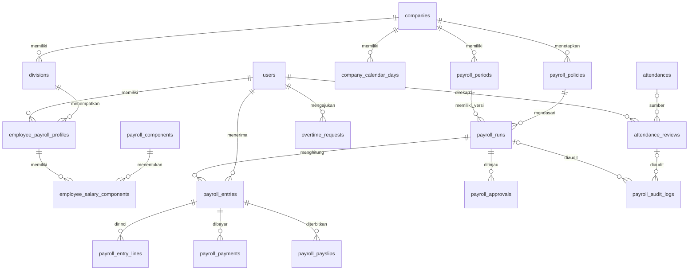

# Rancangan database penggajian

## Cakupan implementasi

Empat migrasi menambahkan 16 tabel. Sumber kehadiran adalah `attendances`
(aplikasi absensi), bukan fingerprint. Tabel dan data lama tidak diubah.
Belum ada kalkulator gaji, endpoint, UI, pengiriman slip, atau transfer bank.
Tidak ada nominal maupun rumus kantor yang diasumsikan sebagai kebijakan final.

Persetujuan dilakukan per perusahaan dan periode, dengan rincian per karyawan
serta ringkasan per divisi. `users.position_id` tetap berarti jabatan.
Divisi disimpan dalam profil penggajian bertanggal berlaku, sehingga perpindahan
divisi tidak menimpa histori. Belum ada pemetaan otomatis jabatan menjadi divisi.

## Breakdown tabel

| Tabel | Fungsi dan kolom utama |
| --- | --- |
| `divisions` | Divisi per perusahaan: `company_id`, `code`, `name`, `is_active`. Kode unik dalam satu perusahaan. |
| `payroll_components` | Kamus komponen per perusahaan: kode, nama, jenis earning/deduction/employer_contribution, kategori gaji pokok/tunjangan/insentif/lembur/reward/potongan/asuransi/pajak/lainnya. |
| `payroll_policies` | Versi aturan: perusahaan, kode, versi, tanggal berlaku, `rules` JSON, pembuat. Berisi parameter deklaratif dan kode algoritme yang dikenal aplikasi; tidak mengeksekusi rumus PHP/SQL dari database. |
| `employee_payroll_profiles` | Profil efektif per karyawan: perusahaan, divisi, jabatan, tanggal berlaku, masa kerja, jenis hubungan kerja, rekening dan identitas pajak/asuransi. |
| `employee_salary_components` | Nilai komponen untuk satu versi profil: komponen, nominal, basis monthly/daily/hourly/fixed. Gaji pokok menjadi komponen, bukan kolom nominal kedua. |
| `company_calendar_days` | Kalender kerja nyata per tanggal/perusahaan, termasuk hari istirahat, hari libur dan snapshot jadwal. Tidak menganggap semua tanggal sebagai hari kerja. |
| `attendance_reviews` | Hasil pemeriksaan HRD per karyawan/hari, tautan opsional ke absensi asli, jam efektif, menit kerja/telat/pulang cepat/izin, snapshot sumber/jadwal/izin, alasan koreksi, bukti, validator dan versi. |
| `overtime_requests` | Rentang lembur, jeda, menit disetujui, alasan, keputusan dan pemroses. Jam pulang lebih lama tidak otomatis dianggap lembur berbayar. |
| `payroll_periods` | Periode per perusahaan, tanggal gaji, cutoff absensi terpisah, tanggal rencana bayar, mata uang, status open/closed. |
| `payroll_runs` | Versi perhitungan satu periode, hubungan ke versi lama, kebijakan dan snapshot perusahaan, status, total, pembuat dan waktu pengajuan/persetujuan/penguncian. |
| `payroll_entries` | Satu hasil per karyawan per run: profil, divisi, snapshot identitas/absensi/kompensasi, tujuan bayar, gross, reward, potongan, kontribusi perusahaan dan net. |
| `payroll_entry_lines` | Rincian komponen: snapshot nama/kode/jenis, quantity, rate, amount, sumber, rincian perhitungan dan alasan penyesuaian. `line_key` mencegah duplikasi akibat penghitungan ulang dalam entry yang sama. |
| `payroll_approvals` | Riwayat submit, revisi, approve, lock, permintaan/keputusan reopen, supersede dan cancel, beserta status awal/akhir, pelaku dan catatan. |
| `payroll_payments` | Catatan pembayaran per karyawan, mendukung cicilan: nominal, metode, status, referensi, bukti privat, tujuan bayar, pencatat dan konfirmator. UUID idempotensi unik. Tidak mengirim uang. |
| `payroll_payslips` | Slip versi tertentu, nomor unik, snapshot isi, lokasi berkas privat, checksum dan waktu/pelaku publikasi. |
| `payroll_audit_logs` | Riwayat koreksi/penyesuaian, entitas, sebelum/sesudah, alasan, snapshot pelaku; opsional terkait run atau review absensi. |

## Relasi utama



## Aturan perhitungan dan snapshot

- Nilai uang `DECIMAL(18,2)`, tarif `DECIMAL(18,4)`, kuantitas `DECIMAL(12,4)`.
  Kalkulator wajib menggunakan aritmetika desimal, bukan float PHP. Kebijakan
  menentukan pembulatan. SQLite pengujian bukan bukti presisi desimal MySQL.
- `gross = SUM(earning)`, `deduction = SUM(deduction)`, `net = gross - deduction`.
  Reward adalah bagian dari earning/gross: jangan ditambahkan dua kali.
  `reward_total` hanya subtotal informasi. Kontribusi perusahaan berada di luar
  gross/net karyawan; biaya perusahaan adalah gross + kontribusi perusahaan.
- Total divisi dihitung dari entry versi run yang dipilih, bukan semua versi.
  Total run merupakan cache agregasi, diperiksa ulang ketika submit/approve.
- Snapshot absensi entry memuat setiap tanggal, ID/versi review, nilai menit,
  klasifikasi, jadwal dan izin yang mendasari. Jangan hanya menyimpan ID sumber.
- Snapshot kompensasi menyimpan semua profil efektif yang dipakai bila berubah
  di tengah periode, aturan prorata, nominal, divisi/jabatan dan tanggal berlaku.
  `employee_payroll_profile_id` adalah profil utama; grouping awal menggunakan
  satu divisi snapshot per karyawan/run. Alokasi biaya lintas divisi dalam satu
  periode belum termasuk cakupan.
- `calculation_snapshot` line menyimpan kode/versi aturan, input, hasil sebelum
  pembulatan, pembulatan, ID sumber dan salinan nilai sumber. Reward dapat
  menyimpan skor, kriteria, hasil evaluasi dan alasan override di sini; tidak
  perlu tabel reward kedua yang menduplikasi jumlah uang payroll.
- Simpan izin parsial sebagai menit dan snapshot izin, bukan menghilangkan
  keseluruhan kehadiran hari tersebut. Kalender kosong/absen tidak lengkap
  harus menghasilkan unresolved, bukan alpha otomatis.

## Workflow yang harus diimplementasikan pada service berikutnya

```text
DRAFT -> SUBMITTED -> APPROVED -> LOCKED -> PARTIALLY_PAID -> PAID
              |
              v
       REVISION_REQUESTED -> versi DRAFT baru -> SUBMITTED
```

Run lama tetap disimpan, versi baru menunjuk `supersedes_run_id`. Revisi
membutuhkan catatan; versi baru perlu approval baru. Hanya satu versi aktif
untuk pembayaran dalam satu periode. Gunakan lock pada row periode ketika
membuat versi, menyetujui dan mengonfirmasi pembayaran.

Reopen run terkunci memerlukan permintaan + persetujuan Manager. Run yang sudah
memiliki pembayaran terkonfirmasi tidak boleh diganti untuk dibayar ulang;
koreksi dilakukan sebagai line adjustment di periode berikutnya, dengan
referensi entry asal pada calculation_snapshot. Jangan menghapus bukti bayar.

## Batas jaminan database dan kewajiban implementasi aplikasi

Database sudah menerapkan foreign key, enum status/jenis, keunikan periode,
versi run, karyawan/run, review karyawan/tanggal, komponen/profil, slip/versi,
serta idempotensi pembayaran. Riwayat payroll memakai RESTRICT pada data induk,
bukan cascade delete. Penghapusan karyawan yang telah memiliki histori payroll
akan ditolak database; UI hapus akun harus menangani kondisi ini dan menawarkan
penonaktifan sesuai kebijakan retensi. Pelaku tindakan dapat null ketika akun
pelaku dihapus, tetapi snapshot pelakunya tetap tersedia.

Kolom status, snapshot dan tabel audit **tidak otomatis** menerapkan workflow,
enkripsi atau immutability. Sebelum endpoint payroll dibuka, service/policy
harus menerapkan dan menguji:

1. Pembatasan HRD/Manager/petugas pembayaran dan pemilik slip. Semua FK perusahaan,
   profil, divisi, komponen, kebijakan dan periode harus konsisten. FK biasa
   memastikan referensi ada, bukan memastikan perusahaan semua referensi sama.
2. Urutan tanggal, tidak ada rentang profil/kebijakan/periode tumpang tindih,
   nominal/menit yang valid, saldo pembayaran tidak melebihi net, dan persamaan
   total. Nilai amount line nonnegatif; jenis earning/deduction menentukan arah.
3. Kalender lengkap, semua review tervalidasi, persetujuan lembur, serta versi
   kebijakan yang cocok sebelum perhitungan bisa diajukan. Perubahan sumber
   setelah kalkulasi harus memicu kalkulasi ulang/versi baru sebelum approval.
4. Transaksi, row locking, transisi status sah, larangan mengedit run/entry/line
   yang sudah submitted atau locked, larangan melewati approval, dan log audit
   append-only. Tidak ada trigger database yang menyatakan ini sudah terlaksana.
5. Alasan + bukti koreksi bila diperlukan; actor berasal dari session pengguna,
   bukan request body. Audit dan approval ditulis dalam transaksi yang sama.
6. Enkripsi melalui encrypted cast Laravel untuk kolom rekening/identitas dan
   payment_destination/destination_snapshot. Kolom TEXT menyediakan ruang untuk
   ciphertext, belum mengenkripsi otomatis. Hindari data sensitif dalam JSON
   snapshot biasa dan log audit. Slip/bukti disimpan privat dengan otorisasi.
7. Publikasi slip hanya dari run locked, izin baca hanya pemilik/role berwenang.
   Konfirmasi pembayaran terpisah dari approval payroll.

## Migrasi dan verifikasi

Empat file `database/migrations/2026_10_03_100*.php` dapat di-rollback dalam urutan
terbalik. Jangan gunakan migrate:fresh pada database kerja. Jalankan
`php artisan migrate` untuk menambahkan tabel setelah meninjau migrasi pending.

Tes `tests/Feature/PayrollSchemaTest.php` memeriksa retensi snapshot, larangan
hapus histori, duplikasi karyawan/run, retry pembayaran, riwayat revisi,
review tanpa absensi, serta rollback/reapply yang menjaga tabel lama.

Belum ada seeder payroll: HRD perlu menentukan divisi, profil gaji, kalender,
komponen dan aturan nyata. Contoh nominal dari diskusi tidak dimasukkan.
